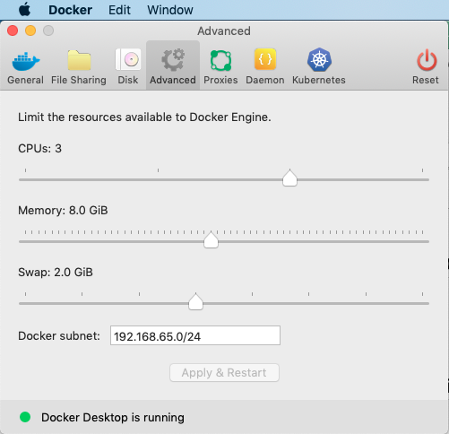

# Running GrimoireLab with docker-compose

This folder host configuration files to run GrimoireLab using 
[docker-compose](https://docs.docker.com/compose/), one of the 
easiest way to get started with GrimoireLab.

# Requirements

* A [Git](https://git-scm.com/) client
* [Docker Engine](https://docs.docker.com/install/) and [Docker Compose v2](https://docs.docker.com/compose/install/) (the `docker compose` command).
  The compose file has no `version:` key, so the legacy standalone `docker-compose` (v1) needs to be 1.27.0 or later.
* Recommended, at least, 2CPUs, 8GB memory RAM, and 2GB SWAP (MacOS users can manage it with [Docker client for Mac](https://hub.docker.com/editions/community/docker-ce-desktop-mac))

For example, in one of my latest demos, I was using:
```console
root@qiskit-6fc71ea6:~# git --version
git version 2.17.1
root@qiskit-6fc71ea6:~# free
              total        used        free      shared  buff/cache   available
Mem:        8167996     3463652      128844        1440     4575500     4413328
Swap:             0           0           0
root@qiskit-6fc71ea6:~# du -hs /
du: cannot access '/proc/2234/task/2234/fd/4': No such file or directory
du: cannot access '/proc/2234/task/2234/fdinfo/4': No such file or directory
du: cannot access '/proc/2234/fd/3': No such file or directory
du: cannot access '/proc/2234/fdinfo/3': No such file or directory
26G     /
```
**Note**: `free` and `du` are Linux utilities to display amount of free and used 
memory in the system, and to estimate file space usage, respectively.

You should ensure [enough virtual memory for OpenSearch](https://docs.opensearch.org/latest/install-and-configure/install-opensearch/index/#important-settings) 
(one of GrimoireLab components). You can do it running the following command as `root` in Linux or as administrator user in MacOS:

## Linux
```console
sysctl -w vm.max_map_count=262144
```

## Mac
```
$ screen ~/Library/Containers/com.docker.docker/Data/vms/0/tty
(then run:) sysctl -w vm.max_map_count=262144
```

Remember also to assign proper resources to Docker through the UI. 8GB Memory and 2GB Swap should work.



# Getting started in 3 steps

1. Clone this project:
```console
git clone https://github.com/chaoss/grimoirelab
```

2. By default, this repository comes with some configuration files in [`default-grimoirelab-settings`](../default-grimoirelab-settings).
These files are the minimum set up to analyze git activity in this repository. If you want to analyze a different project with a different
set of repositories and data sources, you need to modify [`projects.json`](../default-grimoirelab-settings/projects.json) and
[`setup.cfg`](../default-grimoirelab-settings/setup.cfg) files. See [below](#more-information) more information about these files format.

3. Access to [`docker-compose`](./) folder and deploy GrimoireLab running this command:
```console
cd grimoirelab/docker-compose
docker compose up -d
```

If everything goes well, data will be gathered and processed. To get access to
them, go to `http://localhost:8000/`. To get access:
* User: `admin`
* Password: `GrimoireLab.1`

To manage contributors profile information with [SortingHat](https://github.com/chaoss/grimoirelab-sortinghat),
go to `http://localhost:8000/identities/`. To get access:
* User: `admin`
* Pass: `admin`

**Note**: you can change user and password in the `docker-compose.yml` file.

The GrimoireLab and SortingHat images use `latest` by default, while the other
services (MariaDB, Valkey, OpenSearch, nginx) are pinned. To run a specific
GrimoireLab release instead, set `GRIMOIRELAB_VERSION` (see the
[available tags](https://hub.docker.com/r/grimoirelab/grimoirelab/tags)):
```console
GRIMOIRELAB_VERSION=1.21.0 docker compose up -d
```

This version doesn't come with visualizations. To get dashboards, download the
`.ndjson` file of each one you want from the [Sigils repository](https://github.com/chaoss/grimoirelab-sigils/tree/main/panels/json/opensearch_dashboards)
(e.g. `git.ndjson`, `overview.ndjson`) and import it, either:

* from the UI: go to `http://localhost:8000/`, switch to the **Global** tenant
  (user menu, *Switch tenants*), then open *Dashboards Management* → *Saved objects*
  → *Import* and select the file; or
* from the command line:
  ```console
  curl -u admin:GrimoireLab.1 -H "osd-xsrf: true" -H "securitytenant: global" \
       -X POST "http://localhost:5601/api/saved_objects/_import?overwrite=true" \
       --form file=@git.ndjson
  ```

Import them into the Global tenant so every user sees them: without
`securitytenant: global`, the command line import saves them in the `admin`
user's private tenant instead. You can also create your own dashboards.

# More information

* [The `projects.json` file format](https://github.com/chaoss/grimoirelab-sirmordred#projectsjson-)
* [The `setup.cfg` file format](https://github.com/chaoss/grimoirelab-sirmordred#setupcfg-)
* Getting API tokens for different services:
  * [GitHub](https://help.github.com/en/articles/creating-a-personal-access-token-for-the-command-line)
  * [GitLab](https://docs.gitlab.com/ee/user/profile/personal_access_tokens.html)
  * [Slack](https://get.slack.help/hc/en-us/articles/215770388-Create-and-regenerate-API-tokens)

## Common questions

### Why do the dashboards show no data?

1. **Collection is still running.** Mordred needs some time to collect and enrich
   the data: 10-15 minutes for small repositories, much longer for big ones. Follow
   its progress with `docker compose logs -f mordred` (with the default
   `docker-compose.yml`, the log is also written to `/tmp/all.log` on the host).
2. **Check that the indices have data.** The default configuration collects git
   data into `git_demo_raw` and `git_demo_enriched`, and the dashboards read it
   through aliases such as `git`:
   ```console
   curl -k -u admin:GrimoireLab.1 "https://localhost:9200/_cat/indices?v"
   curl -k -u admin:GrimoireLab.1 "https://localhost:9200/_cat/aliases?v"
   ```
3. **If collection fails** (e.g. `Could not resolve host` or timeouts in the
   logs), check that the mordred container can reach the repositories:
   ```console
   docker compose exec mordred git ls-remote https://github.com/chaoss/grimoirelab
   ```
   If it can't, the problem is the container's network (a firewall, DNS or a proxy),
   not GrimoireLab.
4. **If the indices have data but the dashboards are empty**, widen the time range
   in the time picker. The dashboards open with the default range, *Last 15
   minutes*, which leaves out older activity. Also check that you are in the tenant
   where you imported the dashboards (see above).

### How to stop and restart deployed software infrastructure?

There might be 2 potential scenarios:

1. If you want to do a simple configuration change and restart the platform:
```console
docker compose restart
```
2. If you want to destroy current deployed configuration, and after some changes,
start from fresh one:
```console
docker compose down
```
and once they are *down*:
```console
docker compose up -d
```
